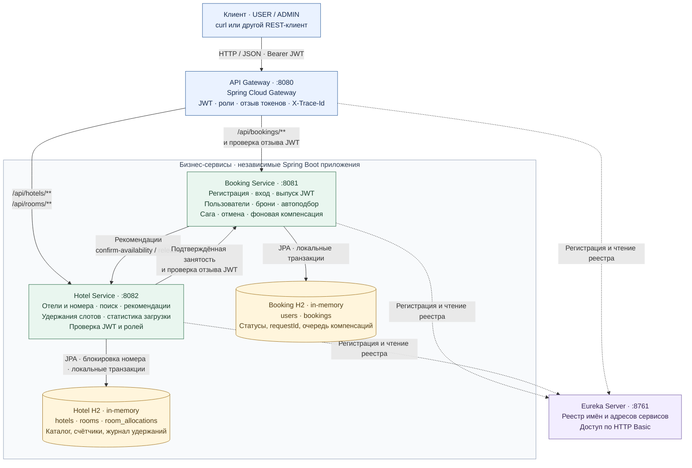
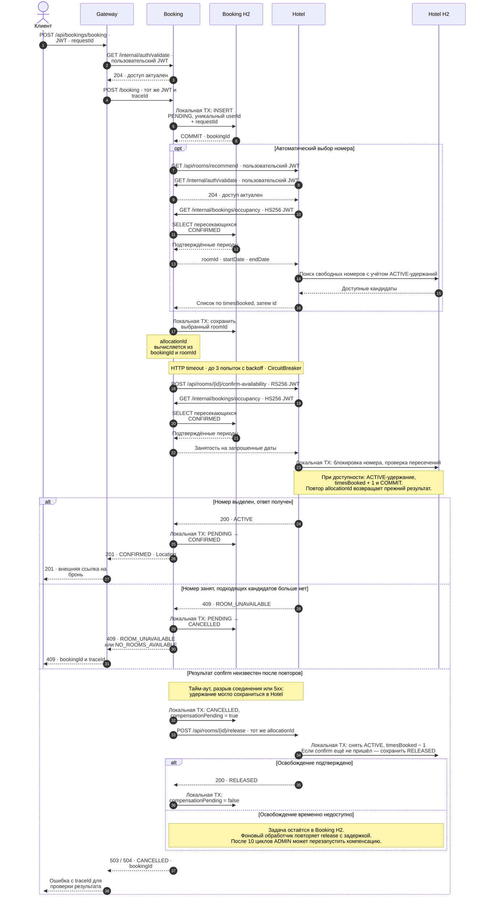

# Hotel Booking

Учебный REST API системы бронирования отелей на Spring Boot. Пользователь регистрируется, ищет свободные номера и создаёт или отменяет бронь. Администратор управляет каталогом и пользователями, просматривает загрузку отелей.

**Стек:** Java 21, Spring Boot 3.5, Spring Cloud Gateway и Eureka, Spring Security и JWT, Spring Data JPA, H2, Resilience4j, Springdoc.

[Архитектура](#архитектура) · [Запуск](#запуск) · [Пример бронирования](#пример-бронирования) · [API](#api) · [Проверки](#проверки)

## Архитектура

| Модуль | Порт | Назначение |
| --- | ---: | --- |
| [api-gateway](api-gateway) | 8080 | Входная точка, проверка доступа и маршрутизация |
| [booking-service](booking-service) | 8081 | Пользователи, бронирования и подтверждённая занятость |
| [hotel-service](hotel-service) | 8082 | Каталог отелей и номеров, удержания слотов, статистика |
| [eureka-server](eureka-server) | 8761 | Регистрация и обнаружение сервисов |
| [shared-support](shared-support) | — | Общие правила дат, JWT, ошибки, трассировка и демо-данные |

Клиент обращается к Gateway, который направляет запросы в Booking или Hotel. Сервисы находят друг друга через Eureka. Booking подтверждает выделение номера в Hotel; Hotel получает подтверждённые периоды занятости из Booking. У каждого бизнес-сервиса своя H2 в памяти.

### Компоненты и взаимодействия



Сплошные стрелки — HTTP-запросы и обращения к собственной БД; пунктир — регистрация и получение адресов через Eureka. Gateway использует `lb://booking-service` и `lb://hotel-service`, межсервисные клиенты также выбирают экземпляры из реестра. Eureka возвращает адреса; бизнес-запросы идут напрямую между приложениями.

**Границы данных.** Booking хранит пользователей в `users`, а бронирования и подтверждённую занятость — в `bookings`. Hotel читает занятые периоды через HTTP и дополняет их локальными удержаниями из `room_allocations`. Каждый сервис обращается только к собственной H2. `shared-support` встроен как JAR в Gateway, Booking и Hotel и содержит общие правила JWT, дат, ошибок и трассировки.

**HTTP-контракты между приложениями:**

| Кто вызывает → кого | Операция | Авторизация |
| --- | --- | --- |
| Gateway → Booking | Внешние операции `/api/bookings/**`; перед передачей префикс `/api/bookings` удаляется | Пользовательский RS256 JWT; регистрация и вход публичны |
| Gateway → Hotel | Внешние операции `/api/hotels/**` и `/api/rooms/**`; путь сохраняется | Пользовательский RS256 JWT |
| Gateway и Hotel → Booking | `GET /internal/auth/validate` — проверка существования пользователя и версии доступа | Тот же пользовательский JWT |
| Booking → Hotel | `GET /api/rooms/recommend` — свободные номера по `timesBooked`, затем `id` | Пользовательский RS256 JWT |
| Booking → Hotel | `POST /api/rooms/{id}/confirm-availability` и `POST /api/rooms/{id}/release` | Служебный RS256 JWT Booking, 5 минут |
| Hotel → Booking | `GET /internal/bookings/occupancy` — подтверждённые занятые периоды | Отдельный HS256 JWT Hotel, 60 секунд |

Gateway публикует только перечисленные в разделе [API](#api) операции. Служебные confirm/release, проверка отзыва и чтение занятости вызываются напрямую между сервисами. Пользовательский JWT проверяется самостоятельно в Gateway и обоих бизнес-сервисах; Booking дополнительно сверяет версию доступа со своей БД.

### Подтверждение бронирования и компенсация

Схема показывает новую бронь с выбранным номером. При автоподборе Booking сначала получает рекомендации и после `409 ROOM_UNAVAILABLE` переходит к следующему кандидату. Повтор исходного `requestId` возвращает уже созданную бронь, а служебные повторы используют тот же `allocationId`.

<details>
<summary>Пошаговая схема: автоподбор, подтверждение, отказ и компенсация</summary>



HTTP-вызовы выполняются между локальными транзакциями. Ошибка сохранения `CONFIRMED` также приводит к отмене и компенсации. Если release опередил confirm, запись `RELEASED` не позволит запоздалому запросу снова удержать номер. Освобождение работает по локальному журналу Hotel и доступно при отказе источника занятости в Booking.

</details>

### Ключевые решения

| Решение | Зачем |
| --- | --- |
| Локальные транзакции и компенсация | Согласовать бронь и выделение номера без глобальной транзакции |
| `requestId` и `allocationId` | Обрабатывать повторы без дублей и повторного изменения счётчиков |
| Занятость по `bookings`, удержания в `room_allocations` | Отделить подтверждённые проживания от незавершённых операций |
| JWT в Gateway и бизнес-сервисах | Проверять доступ и при обращении напрямую к сервису |
| Общая библиотека | Повторно использовать инфраструктурный код без общей базы данных |

## Запуск

Нужны **JDK 21**, OpenSSL и `curl`. Примеры ниже рассчитаны на Bash/Zsh; для примера бронирования и нагрузки нужен Python 3.9+ с базой часовых поясов. Все команды выполняются из корня проекта.

### 1. Собрать проект

На macOS выберите JDK 21 и запустите Maven Wrapper:

```sh
export JAVA_HOME="$(/usr/libexec/java_home -v 21)"
./mvnw clean verify
```

На Linux задайте `JAVA_HOME` с путём к JDK 21 и выполните `./mvnw clean verify`. На Windows используйте `mvnw.cmd clean verify`. Wrapper загрузит Maven 3.9.11 и зависимости. Результат — четыре запускаемых JAR и библиотека `shared-support`.

### 2. Подготовить ключи и запустить Eureka

```sh
umask 077
mkdir -p secrets
test -s secrets/booking-private.pem || \
  openssl genpkey -algorithm RSA -pkeyopt rsa_keygen_bits:2048 -out secrets/booking-private.pem
openssl pkey -in secrets/booking-private.pem -pubout -out secrets/booking-public.pem

export OCCUPANCY_SHARED_SECRET="$(openssl rand -hex 32)"
export EUREKA_USERNAME=registry
export EUREKA_PASSWORD="$(openssl rand -hex 24)"
export BOOKING_ADMIN_USERNAME=demo-admin
export BOOKING_ADMIN_PASSWORD="$(openssl rand -hex 16)"
export DEMO_USER_PASSWORD="$(openssl rand -hex 16)"
export DEMO_DATE=2026-11-06
app_profiles=local,demo

"$JAVA_HOME/bin/java" -jar eureka-server/target/eureka-server-0.1.0-SNAPSHOT.jar &
eureka_pid=$!
```

Дождитесь ответа `{"status":"UP"}`:

```sh
curl -fsS http://127.0.0.1:8761/actuator/health
```

`local,demo` загружает примеры данных. Для пустых бизнес-баз задайте `app_profiles=local`. `DEMO_DATE` фиксирует дату демо-снимка; без неё используется текущая дата по Москве.

### 3. Запустить остальные сервисы

Выполните в том же терминале, чтобы приложения получили общие переменные окружения:

```sh
"$JAVA_HOME/bin/java" -jar booking-service/target/booking-service-0.1.0-SNAPSHOT.jar --spring.profiles.active="$app_profiles" &
booking_pid=$!
"$JAVA_HOME/bin/java" -jar hotel-service/target/hotel-service-0.1.0-SNAPSHOT.jar --spring.profiles.active="$app_profiles" &
hotel_pid=$!
"$JAVA_HOME/bin/java" -jar api-gateway/target/api-gateway-0.1.0-SNAPSHOT.jar &
gateway_pid=$!
```

Проверьте состояние приложений:

```sh
for port in 8080 8081 8082; do
  curl -fsS "http://127.0.0.1:$port/actuator/health"
  printf '\n'
done
```

В [Eureka](http://127.0.0.1:8761/) должны появиться `BOOKING-SERVICE`, `HOTEL-SERVICE` и `API-GATEWAY`. Панель принимает логин и пароль из `EUREKA_USERNAME` и `EUREKA_PASSWORD`. Обновление реестра у клиентов выполняется каждые пять секунд; сразу после запуска возможен временный `503` от Gateway.

Запускайте по одному экземпляру Booking и Hotel. Их данные хранятся в памяти: для чистого повторного прогона перезапустите оба сервиса.

<details>
<summary>Остановка и дополнительные настройки запуска</summary>

```sh
kill "$gateway_pid" "$hotel_pid" "$booking_pid"
wait "$gateway_pid" "$hotel_pid" "$booking_pid" || true
kill "$eureka_pid"
```

| Настройка | Назначение |
| --- | --- |
| `EUREKA_URL` | Адрес реестра у трёх клиентов; по умолчанию `http://127.0.0.1:8761/eureka/` |
| `BOOKING_JWT_PRIVATE_KEY`, `BOOKING_JWT_PUBLIC_KEY` | PEM-ключи Booking; по умолчанию файлы в `secrets/` |
| `HOTEL_JWT_PUBLIC_KEY`, `GATEWAY_JWT_PUBLIC_KEY` | Открытый ключ Booking для проверки JWT |
| `BOOKING_JWT_ISSUER`, `HOTEL_JWT_ISSUER`, `GATEWAY_JWT_ISSUER` | Один издатель JWT; по умолчанию `http://booking-service` |
| `OCCUPANCY_SHARED_SECRET` | Общий случайный секрет двух бизнес-сервисов для чтения занятости, минимум 32 байта |

Пути к ключам задаются как Spring Resource, например `file:/путь/к/ключу.pem`. Приложения по умолчанию слушают `127.0.0.1`.

</details>

## Пример бронирования

В демо есть два отеля, пять номеров, два гостя с историей проживаний и администратор. Гости `demo-alice` и `demo-bob` используют `DEMO_USER_PASSWORD`, администратор — `BOOKING_ADMIN_USERNAME` и `BOOKING_ADMIN_PASSWORD`.

Получите токены и создайте бронь номера `910002` на завтра:

```sh
USER_TOKEN="$(printf '{"username":"demo-alice","password":"%s"}' "$DEMO_USER_PASSWORD" |
  curl -fsS http://127.0.0.1:8080/api/bookings/user/auth \
    -H 'Content-Type: application/json' --data-binary @- |
  python3 -c 'import json, sys; print(json.load(sys.stdin)["accessToken"])')"

ADMIN_TOKEN="$(printf '{"username":"%s","password":"%s"}' "$BOOKING_ADMIN_USERNAME" "$BOOKING_ADMIN_PASSWORD" |
  curl -fsS http://127.0.0.1:8080/api/bookings/user/auth \
    -H 'Content-Type: application/json' --data-binary @- |
  python3 -c 'import json, sys; print(json.load(sys.stdin)["accessToken"])')"

START_DATE="$(python3 -c 'from datetime import datetime, timedelta; from zoneinfo import ZoneInfo; print(datetime.now(ZoneInfo("Europe/Moscow")).date() + timedelta(days=1))')"
END_DATE="$(python3 -c 'from datetime import date, timedelta; import sys; print(date.fromisoformat(sys.argv[1]) + timedelta(days=1))' "$START_DATE")"
REQUEST_ID="$(python3 -c 'import uuid; print(uuid.uuid4())')"

curl -si http://127.0.0.1:8080/api/bookings/booking \
  -H "Authorization: Bearer $USER_TOKEN" -H 'Content-Type: application/json' \
  -d "{\"requestId\":\"$REQUEST_ID\",\"autoSelect\":false,\"roomId\":910002,\"startDate\":\"$START_DATE\",\"endDate\":\"$END_DATE\"}"
```

Ожидаемый ответ — **201**, статус `CONFIRMED`, заголовок `Location` с адресом брони. Повтор того же запроса с тем же `requestId` вернёт **200** и прежний ID. Если исходная операция ещё выполняется, повтор получит **202**.

Проверьте свою историю:

```sh
curl -i http://127.0.0.1:8080/api/bookings/bookings \
  -H "Authorization: Bearer $USER_TOKEN"
```

## API

Все пути в таблице доступны через **`http://127.0.0.1:8080`**. Для защищённых запросов передайте `Authorization: Bearer <accessToken>`.

| Область | Метод и путь | Доступ |
| --- | --- | --- |
| Регистрация и вход | `POST /api/bookings/user/register`, `POST /api/bookings/user/auth` | Публично |
| Создание брони | `POST /api/bookings/booking` | USER, ADMIN |
| Своя история | `GET /api/bookings/bookings` | USER, ADMIN |
| Своя бронь и отмена | `GET`, `DELETE /api/bookings/booking/{id}` | USER, ADMIN |
| Рекомендации через Booking | `GET /api/bookings/rooms/recommend` | USER, ADMIN |
| Создание пользователя | `POST /api/bookings/user` | ADMIN |
| Список пользователей | `GET /api/bookings/users` | ADMIN |
| Управление пользователем | `GET`, `PATCH`, `DELETE /api/bookings/user/{id}` | ADMIN |
| Повтор компенсации | `POST /api/bookings/booking/{id}/compensation` | ADMIN |
| Чтение отелей | `GET /api/hotels`, `GET /api/hotels/{id}` | USER, ADMIN |
| Управление отелями | `POST /api/hotels`, `PATCH`, `DELETE /api/hotels/{id}` | ADMIN |
| Свободные номера | `GET /api/rooms`, `GET /api/rooms/recommend` | USER, ADMIN |
| Карточка номера | `GET /api/rooms/{id}` | USER, ADMIN |
| Управление номерами | `POST /api/rooms`, `PATCH`, `DELETE /api/rooms/{id}` | ADMIN |
| Полный каталог номеров | `GET /api/rooms/catalog` | ADMIN |
| Статистика | `GET /api/rooms/statistics`, `GET /api/hotels/statistics` | ADMIN |

**Swagger UI:** [Booking](http://127.0.0.1:8081/swagger-ui.html) · [Hotel](http://127.0.0.1:8082/swagger-ui.html). Схемы запросов и ответов доступны на `/v3/api-docs` соответствующего сервиса. Для проверки защищённых операций вставьте `accessToken` в **Authorize**.

При прямом обращении к Booking убирается префикс `/api/bookings`; пути Hotel остаются прежними. Gateway возвращает внешние адреса в `Location` и не публикует служебные маршруты.

### Правила работы с API

- **Даты:** интервал `[startDate, endDate)`, формат `YYYY-MM-DD`. Заезд от сегодняшней даты по Москве до 365 дней вперёд, проживание от 1 до 30 ночей. Отмена разрешена до дня заезда; история доступна только владельцу, включая ADMIN.
- **Выбор номера:** при `autoSelect=false` нужен `roomId`; при `true` он игнорируется, а `hotelId` служит необязательным фильтром. Рекомендации упорядочены по `timesBooked`, затем по `id`. Подбор читает порции по десять и продолжает поиск после конфликтов.
- **Повторы:** `requestId` — UUID, уникальный для пользователя. Изменение параметров при том же ключе даёт `409 REQUEST_ID_CONFLICT`.
- **Страницы:** `page` с нуля, `size` от 1 до 100; по умолчанию `0` и `20`. Ответ — массив записей, общее количество передаётся в `X-Total-Count`.
- **Каталог:** отели фильтруются по части `name` и `address`; номера — по `hotelId` и признаку эксплуатации `available`. Поиск свободных номеров требует даты. Отель с номерами удалить нельзя; номер с историей броней или выделений отключают вместо удаления.
- **PATCH:** меняет только переданные поля. Пустой объект, `null`, неизвестные поля и неверные типы отклоняются. Одновременные изменения пользователя защищены версией записи; устаревший запрос получает `409 CONCURRENT_MODIFICATION`.
- **Ошибки:** общий формат `ErrorDTO` содержит `code`, `message`, `timestamp`, `path`, `traceId`; при необходимости — `fieldErrors` и `bookingId`. Основные статусы: `400`, `401`, `403`, `404`, `409`, `503`, `504`.

<details>
<summary>Аналитика загрузки</summary>

Отчёты `/api/rooms/statistics` и `/api/hotels/statistics` принимают `startDate`, `endDate`, `hotelId`, `available`, `page`, `size` и `sort=поле[,asc|desc]`. Для отчётов допустимы прошлые даты. Без дат статистика номеров показывает текущие счётчики и число текущих и будущих подтверждённых проживаний.

| Показатель | Значение |
| --- | --- |
| `allocationCount` | Число подтверждённых броней, пересекающихся с периодом |
| `occupiedRoomNights` | Занятые номеро-ночи, включая историю закрытых номеров |
| `capacityRoomNights` | Ночи периода × число доступных сейчас номеров |
| `occupancyPercent` | Занятые ночи доступного фонда / вместимость × 100; `null` при нулевой вместимости |
| `timesBookedSpread` | Разница максимального и минимального счётчика среди доступных номеров отеля |

Общие сортировки: `id`, `allocationCount`, `occupiedRoomNights`, `occupancyPercent`. Дополнительно доступны `timesBooked` для номеров и `timesBookedSpread` для отелей. При равенстве используется ID.

</details>

## Технические детали

<details>
<summary>Безопасность и трассировка</summary>

Пользовательские JWT подписываются Booking алгоритмом RS256 и действуют один час. Gateway и бизнес-сервисы самостоятельно проверяют подпись и claims. Gateway и Hotel дополнительно сверяют версию доступа с Booking. Смена роли или пароля отзывает прежние токены; переименование сохраняет их. Без действующего токена ответ `401`, при недостаточной роли — `403`, при недоступной проверке отзыва — `503 AUTH_SERVICE_UNAVAILABLE`.

Пароли хранятся как PBKDF2-хеши с солью. Логин нормализуется, максимальная длина — 64 символа; пароль — от 12 до 128 символов. Удаление пользователя с любой бронью запрещено. Последнего ADMIN нельзя удалить или понизить.

Служебные JWT разделены по назначению: confirm/release используют RS256-токен Booking сроком пять минут, чтение занятости — HS256-токен Hotel сроком 60 секунд с отдельной аудиторией. Пользовательские токены не дают доступа к этим операциям. Eureka защищена HTTP Basic.

Gateway, Booking и Hotel возвращают `X-Trace-Id`. Корректное входное значение — 32 шестнадцатеричных символа, иначе генерируется новый ID. Он доступен в ответах, ошибках и журналах, сохраняется для фоновой компенсации. События бронирования также содержат `bookingId` и `allocationId`.

</details>

<details>
<summary>Подтверждение брони, компенсация и устойчивость</summary>

1. Booking сохраняет `PENDING` в локальной транзакции.
2. Hotel проверяет подтверждённую занятость из `bookings` и под блокировкой номера создаёт локальное удержание.
3. При успехе Booking сохраняет `CONFIRMED`. При сбое — `CANCELLED`, а при неоднозначном результате запускает release того же `allocationId`.
4. Неудачная компенсация сохраняется в БД и повторяется фоновым обработчиком. Release, пришедший раньше confirm, сохраняет `RELEASED` и блокирует запоздалое выделение.

| Механизм | Настройка по умолчанию |
| --- | --- |
| Вызовы Hotel | До 3 попыток на сетевых ошибках и 5xx; паузы 200/400 мс |
| Тайм-ауты | Поиск экземпляра и подключение по 500 мс; ответ 1 с |
| Общий подбор | `booking.selection-timeout=60s`; исчерпание даёт `504 ROOM_SELECTION_TIMEOUT` и CANCELLED |
| CircuitBreaker | Отдельные для confirm/release; 50% сбоев из 10 вызовов, OPEN на 10 с, до 3 проб в HALF_OPEN |
| Компенсация | До 10 циклов, пауза растёт с 1 до 30 с; после исчерпания доступен повтор через ADMIN API |
| Зависший PENDING | Восстановление после 120 с без обновлений |
| Gateway | Ожидание ответа сервиса до 75 с |

Уже начатый confirm может завершиться после бюджета подбора. При неопределённом результате проверка освобождения продолжается, пока `compensationPending=true`. Деловые 4xx не повторяются и не учитываются CircuitBreaker.

Служебные пути доступны напрямую и исключены из Gateway и OpenAPI:

- Hotel: `POST /api/rooms/{id}/confirm-availability`, `POST /api/rooms/{id}/release`.
- Booking: `GET /internal/auth/validate`, `GET /internal/bookings/occupancy`.

Ошибка источника занятости даёт `503 BOOKING_OCCUPANCY_UNAVAILABLE`. Release использует локальный журнал и остаётся доступен при отказе этого источника.

</details>

<details>
<summary>Таблицы и ограничения БД</summary>

| Сервис | Таблица | Основные данные |
| --- | --- | --- |
| Booking | `users` | Уникальный логин, хеш пароля, роль, версия доступа и оптимистическая версия записи |
| Booking | `bookings` | Владелец, номер, даты, статус, ключ запроса, очередь компенсаций |
| Hotel | `hotels` | Название и адрес |
| Hotel | `rooms` | Отель, уникальное внутри отеля обозначение, `available`, неотрицательный `times_booked` |
| Hotel | `room_allocations` | Уникальный `allocation_id`, внешний ID брони, номер, даты и результат confirm/release |

Внутри каждой БД заданы внешние ключи, ограничения уникальности, проверка `end_date > start_date` и индексы истории, занятости и компенсации. Межсервисные связи проверяются через HTTP. `available` обозначает эксплуатационное состояние номера; занятость по датам определяется по подтверждённым `bookings` с учётом локальных удержаний.

</details>

## Проверки

Последний полный прогон — **7 ноября 2026 года**. Чистая сборка и Spotless прошли, **250 тестов**, ошибок и пропусков нет: Hotel — 122, Booking — 78, Gateway — 50.

| Сценарий | Результат |
| --- | --- |
| 50 одновременных автоброней, 10 номеров | 10 подтверждений, 40 конфликтов |
| 50 одновременных автоброней, 30 номеров | 30 подтверждений, 20 конфликтов; все номера заняты |
| 8 запросов на один номер | 1 подтверждение, 7 конфликтов |
| 8 копий одного `requestId` | Одна бронь: один ответ 201, семь ответов 202 |
| 100 последовательных автоброней, 10 номеров | По 10 броней на номер, разброс 0 |
| Сверка 210 записей истории | Нет пересечений, дублей, PENDING и незавершённой компенсации; счётчики согласованы |
| Параллельная смена пароля и роли/логина | Устаревший запрос получает 409; чужое изменение сохраняется |

### Как повторить

```sh
# Все тесты и проверка форматирования
./mvnw clean verify

# Тесты одного сервиса с общей библиотекой
./mvnw -pl booking-service -am test

# Нагрузка на четырёх собранных приложениях
python3 scripts/load-check.py
```

Нагрузочный скрипт создаёт временные ключи, запускает четыре JAR на свободных портах и завершает процессы после проверки. В выводе остаются результаты и путь к журналам.

<details>
<summary>Основные наборы автоматических тестов</summary>

Тесты используют JUnit, MockMvc, WebTestClient, настоящую H2 и управляемые HTTP-сбои.

| Набор | Что проверяет |
| --- | --- |
| `BookingSagaTest` | Подтверждение, компенсацию, повторы, тайм-ауты и CircuitBreaker |
| `UserConcurrencyTest` | Конкурентные изменения пользователей |
| `AllocationConcurrencyTest` | Гонки выделений номеров |
| `CanonicalOccupancyTest` | Занятость по `bookings` |
| `GatewayContractTest` | Маршруты и безопасность |

</details>
