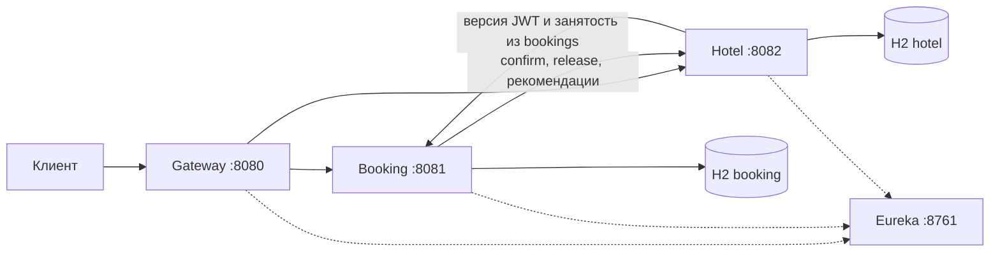

# Hotel Booking

Учебная система бронирования отелей для проекта Skillfactory. Через Gateway гость регистрируется, ищет свободные номера и создаёт или отменяет бронь. Администратор управляет каталогом и пользователями и смотрит загрузку. Booking и Hotel согласуют бронь и занятость через локальные транзакции, подтверждение и компенсацию.

| Модуль | Ответственность |
| --- | --- |
| `hotel-service` | Каталог отелей, номера и занятость по датам |
| `booking-service` | Пользователи, бронирования и источник подтверждённой занятости |
| `eureka-server` | Регистрация и обнаружение сервисов |
| `api-gateway` | Входящие запросы и маршрутизация |
| `shared-support` | Библиотека общего кода для HTTP, безопасности, трассировки и правил дат |



Сплошные стрелки показывают API и хранение данных. Пунктир показывает регистрацию и поиск адреса сервиса. Gateway также обращается к Booking для проверки версии JWT на защищённых запросах.

## Сборка

Требуется JDK 21. Maven Wrapper загрузит Maven 3.9.11 и зависимости при первой сборке. Если на macOS установлено несколько JDK, выберите нужный перед запуском.

```sh
export JAVA_HOME="$(/usr/libexec/java_home -v 21)"
./mvnw clean verify
```

На Windows укажите JDK 21 в `JAVA_HOME` и выполните `mvnw.cmd clean verify`. На Linux экспортируйте `JAVA_HOME` с путём к JDK 21 и выполните `./mvnw clean verify`.

Команда собирает четыре запускаемых JAR и библиотеку `shared-support`. Запускаемые JAR лежат в `target/` соответствующего приложения. `verify` проверяет Java через Spotless. Чтобы применить форматирование, запустите `./mvnw spotless:apply`. Для одного приложения используйте, например, `./mvnw -pl booking-service -am test`, чтобы Maven также собрал общую библиотеку.

## Запуск четырёх приложений

Соберите проект. Для запуска и проверочных запросов нужны OpenSSL, `curl` и оболочка Bash или Zsh. Выполняйте команды из корня проекта в одном терминале, чтобы все процессы получили одинаковые настройки Eureka.

```sh
umask 077
mkdir -p secrets
test -s secrets/booking-private.pem || \
  openssl genpkey -algorithm RSA -pkeyopt rsa_keygen_bits:2048 -out secrets/booking-private.pem
openssl pkey -in secrets/booking-private.pem -pubout -out secrets/booking-public.pem

export OCCUPANCY_SHARED_SECRET="$(openssl rand -hex 32)"
export EUREKA_USERNAME=registry
export EUREKA_PASSWORD="$(openssl rand -hex 24)"
export BOOKING_ADMIN_USERNAME=demo-admin
export BOOKING_ADMIN_PASSWORD="$(openssl rand -hex 16)"
export DEMO_USER_PASSWORD="$(openssl rand -hex 16)"
export DEMO_DATE=2026-11-06
app_profiles=local,demo

"$JAVA_HOME/bin/java" -jar eureka-server/target/eureka-server-0.1.0-SNAPSHOT.jar &
eureka_pid=$!
```

Дождитесь `{"status":"UP"}` от `curl -fsS http://127.0.0.1:8761/actuator/health`, затем запустите клиентов. Для старта с пустыми бизнес-базами задайте `app_profiles=local`.

```sh
"$JAVA_HOME/bin/java" -jar booking-service/target/booking-service-0.1.0-SNAPSHOT.jar --spring.profiles.active="$app_profiles" &
booking_pid=$!
"$JAVA_HOME/bin/java" -jar hotel-service/target/hotel-service-0.1.0-SNAPSHOT.jar --spring.profiles.active="$app_profiles" &
hotel_pid=$!
"$JAVA_HOME/bin/java" -jar api-gateway/target/api-gateway-0.1.0-SNAPSHOT.jar &
gateway_pid=$!
```

Панель `http://127.0.0.1:8761/` и API реестра `/eureka/apps` принимают HTTP Basic с `EUREKA_USERNAME` и `EUREKA_PASSWORD`. В реестре должны появиться `BOOKING-SERVICE`, `HOTEL-SERVICE` и `API-GATEWAY`. Клиенты обновляют локальные копии реестра каждые пять секунд. Для другого порта Eureka задайте `EUREKA_URL` у трёх клиентов, например `http://127.0.0.1:8762/eureka/`. Реквизиты передаются отдельно от URL. Запускайте по одному экземпляру Booking и Hotel, у каждого своя H2 в памяти. Список запущенных из этого терминала процессов можно посмотреть через `jobs`.

Перед примерами проверьте `UP` на портах 8080, 8081 и 8082. Откройте панель Eureka и дождитесь трёх зарегистрированных клиентов. Если сразу после регистрации Gateway отвечает `503 SERVICE_UNAVAILABLE`, дождитесь следующего обновления его локальной копии реестра.

```sh
for port in 8080 8081 8082; do
  curl -fsS "http://127.0.0.1:$port/actuator/health"
  printf '\n'
done
```

Для остановки отправьте SIGTERM клиентам, дождитесь их завершения и остановите Eureka.

```sh
kill "$gateway_pid" "$hotel_pid" "$booking_pid"
wait "$gateway_pid" "$hotel_pid" "$booking_pid" || true
kill "$eureka_pid"
```

Gateway слушает `127.0.0.1:8080` и проверяет пользовательский JWT по открытому ключу Booking. Используйте `GATEWAY_JWT_PUBLIC_KEY=file:/путь/к/ключу.pem`, если ключ находится вне `secrets/booking-public.pem`, и `GATEWAY_JWT_ISSUER`, если изменили издателя в Booking. Регистрация и вход доступны публично. Защищённые запросы дополнительно сверяют версию доступа с Booking. Отозванный токен даёт 401, недоступная проверка — 503 `AUTH_SERVICE_UNAVAILABLE`. При проксировании Gateway ждёт ответ сервиса до 75 секунд, чтобы дать Booking завершить подбор и компенсацию.

| Метод и внешний путь | Доступ |
| --- | --- |
| `POST /api/bookings/user/register`, `POST /api/bookings/user/auth` | Публично |
| `POST /api/bookings/booking`, `GET /api/bookings/bookings` | USER и ADMIN, свои брони |
| `GET` и `DELETE /api/bookings/booking/{id}` | USER и ADMIN, своя бронь |
| `GET /api/bookings/rooms/recommend` | USER и ADMIN |
| `POST /api/bookings/user`, `GET /api/bookings/users` | ADMIN |
| `GET`, `PATCH` и `DELETE /api/bookings/user/{id}` | ADMIN |
| `POST /api/bookings/booking/{id}/compensation` | ADMIN |
| `GET /api/hotels`, `GET /api/hotels/{id}` | USER и ADMIN |
| `POST /api/hotels`, `PATCH` и `DELETE /api/hotels/{id}` | ADMIN |
| `GET /api/rooms`, `GET /api/rooms/{id}`, `GET /api/rooms/recommend` | USER и ADMIN |
| `POST /api/rooms`, `PATCH` и `DELETE /api/rooms/{id}` | ADMIN |
| `GET /api/rooms/catalog`, `GET /api/rooms/statistics`, `GET /api/hotels/statistics` | ADMIN |

Для Booking Gateway снимает `/api/bookings` и добавляет этот префикс в ссылки `Location` из ответов Booking. Пути confirm, release, `/internal/auth/validate` и `/internal/bookings/occupancy` доступны сервисам напрямую. Gateway возвращает 404 на попытку вызвать их через порт 8080.

Gateway, Booking и Hotel возвращают `X-Trace-Id`. Принимается одно значение из 32 шестнадцатеричных символов. Для отсутствующего или неверного значения сервис создаёт новый ID. Найдите его в ответе, поле `traceId` ошибки и журналах трёх приложений. Booking сохраняет ID запроса для фонового release. `requestId` управляет повторами создания, `bookingId` связывает все действия с бронью, `allocationId` связывает confirm и release для одного кандидата.

## Демо и OpenAPI

В профиле `local,demo` пользователи `demo-alice` и `demo-bob` входят с `DEMO_USER_PASSWORD`, администратор — с отдельными реквизитами из `BOOKING_ADMIN_*`. Демо включает отели «Маяк» (`910001`) и «Парк» (`910002`), пять номеров, закрытый номер `910003`, четыре подтверждённых проживания и одну отменённую бронь. История и выделения согласованы по ID и датам. Исторические записи загружаются при старте до приёма HTTP. Если `DEMO_DATE` опущена, берётся текущая дата по Москве. Задайте одну дату для обоих процессов, чтобы воспроизвести тот же снимок.

Проверочный запрос через Gateway использует номер `910002` и вычисляет даты в Москве. Для этого примера нужен Python 3.9+ с базой часовых поясов. Токен остаётся в переменной оболочки.

```sh
USER_TOKEN="$(printf '{"username":"demo-alice","password":"%s"}' "$DEMO_USER_PASSWORD" |
  curl -fsS http://127.0.0.1:8080/api/bookings/user/auth \
    -H 'Content-Type: application/json' --data-binary @- |
  python3 -c 'import json, sys; print(json.load(sys.stdin)["accessToken"])')"

ADMIN_TOKEN="$(printf '{"username":"%s","password":"%s"}' "$BOOKING_ADMIN_USERNAME" "$BOOKING_ADMIN_PASSWORD" |
  curl -fsS http://127.0.0.1:8080/api/bookings/user/auth \
    -H 'Content-Type: application/json' --data-binary @- |
  python3 -c 'import json, sys; print(json.load(sys.stdin)["accessToken"])')"

START_DATE="$(python3 -c 'from datetime import datetime, timedelta; from zoneinfo import ZoneInfo; print(datetime.now(ZoneInfo("Europe/Moscow")).date() + timedelta(days=1))')"
END_DATE="$(python3 -c 'from datetime import date, timedelta; import sys; print(date.fromisoformat(sys.argv[1]) + timedelta(days=1))' "$START_DATE")"
REQUEST_ID="$(python3 -c 'import uuid; print(uuid.uuid4())')"

curl -si http://127.0.0.1:8080/api/bookings/booking \
  -H "Authorization: Bearer $USER_TOKEN" -H 'Content-Type: application/json' \
  -d "{\"requestId\":\"$REQUEST_ID\",\"autoSelect\":false,\"roomId\":910002,\"startDate\":\"$START_DATE\",\"endDate\":\"$END_DATE\"}"
```

Первый запрос возвращает `201 CONFIRMED`. Повторите его с тем же телом для `200` и того же ID. Заголовок `Location` указывает на карточку через Gateway. История доступна по `GET /api/bookings/bookings` с тем же токеном.

Swagger UI доступен напрямую в [Booking](http://127.0.0.1:8081/swagger-ui.html) и [Hotel](http://127.0.0.1:8082/swagger-ui.html). JSON-описания доступны на `/v3/api-docs`. Для защищённого запроса вставьте `accessToken` в **Authorize**. Служебные вызовы описаны в разделе ниже. В Gateway пути Booking получают префикс `/api/bookings`, пути Hotel сохраняются.

Для проверки конкуренции после сборки запустите `python3 scripts/load-check.py`. Понадобятся Python 3.9+ с базой часовых поясов и OpenSSL. Скрипт создаёт временную пару ключей, поднимает четыре JAR на свободных портах и проверяет историю, занятость и счётчики через Gateway. В выводе остаются результаты и путь к журналам. Процессы завершаются по окончании проверки.

## Запуск Hotel Service

```sh
"$JAVA_HOME/bin/java" -jar hotel-service/target/hotel-service-0.1.0-SNAPSHOT.jar
```

По умолчанию Hotel Service использует профиль `local` и слушает `127.0.0.1:8082`. Из другого терминала проверьте состояние сервиса.

```sh
curl -i http://127.0.0.1:8082/actuator/health
```

Ожидаемый ответ — HTTP 200 и `{"status":"UP"}`. Чтобы остановить сервис, нажмите Ctrl+C в терминале, где запущен Java-процесс.

Тесты Hotel работают с профилем `test`. Их можно запустить отдельно командой `./mvnw -pl hotel-service -am test`.

### Доступ к Hotel

Hotel проверяет JWT от Booking самостоятельно, в том числе при обращении в обход Gateway. Ему нужен открытый ключ Booking: по умолчанию `secrets/booking-public.pem` из корня репозитория, другой путь задаёт `HOTEL_JWT_PUBLIC_KEY=file:/путь/к/ключу.pem`. Hotel проверяет подпись RS256, срок, издателя (`HOTEL_JWT_ISSUER`, по умолчанию `http://booking-service`) и аудиторию.

Для пользовательского токена Hotel на каждом защищённом запросе спрашивает Booking, не отозван ли токен (`GET /internal/auth/validate`). Экземпляр `booking-service` выбирается через Eureka и Spring Cloud LoadBalancer. Подключение ограничено 500 мс, ожидание ответа — 1 с.

| Запрос | Доступ |
| --- | --- |
| `GET /actuator/health` | Открыт |
| `GET /api/hotels`, `GET /api/hotels/{id}`, `GET /api/rooms/{id}` | `USER`, `ADMIN` |
| `POST`, `PATCH`, `DELETE` отелей и номеров, `GET /api/rooms/catalog` | `ADMIN` |
| `POST /api/rooms/{id}/confirm-availability`, `/release` | Только служебный токен Booking |

Без токена или с недействительным токеном ответ 401, с недостаточной ролью — 403. Если пользователя удалили или сменили ему роль либо пароль, старый токен сразу получает 401 и в Hotel. Если Booking недоступен, Hotel отвечает 503 `AUTH_SERVICE_UNAVAILABLE` и запрос не выполняет.

Для примеров ниже получите токен администратора через Booking (`POST /user/auth`) и сохраните его в переменной `ADMIN_TOKEN`.

## Каталог отелей

```sh
curl -i http://127.0.0.1:8082/api/hotels \
  -H "Authorization: Bearer $ADMIN_TOKEN" \
  -H 'Content-Type: application/json' \
  -d '{"name":"Отель Маяк","address":"ул. Морская, 7"}'
```

При создании API возвращает HTTP 201, сгенерированный `id` в JSON и путь в заголовке `Location`. Для чтения отправьте GET по этому пути, например `curl -i http://127.0.0.1:8082/api/hotels/1`.

Название и адрес обязательны, каждое поле ограничено 255 символами. Отели хранятся в памяти H2, поэтому после перезапуска Hotel Service каталог снова пуст.

Список `GET /api/hotels` возвращает страницу отелей в порядке возрастания `id`. Фильтры `name` и `address` ищут часть названия и адреса без учёта регистра. По пути из `Location` можно изменить адрес и удалить отель.

```sh
curl -i -X PATCH http://127.0.0.1:8082/api/hotels/1 \
  -H "Authorization: Bearer $ADMIN_TOKEN" \
  -H 'Content-Type: application/json' \
  -d '{"address":"ул. Морская, 9"}'
curl -i -X DELETE http://127.0.0.1:8082/api/hotels/1 \
  -H "Authorization: Bearer $ADMIN_TOKEN"
```

PATCH меняет переданные поля и возвращает отель с кодом 200. Пропущенные поля сохраняют прежние значения. Пустой объект, `null` вместо значения, пустые строки, неизвестные поля и значения других типов дают 400. Успешный DELETE возвращает 204. Повторный DELETE по тому же адресу возвращает 404.

Для ошибок каталога ответ содержит `code`, `message`, `timestamp` и `path`. При ошибках валидации полей есть также `fieldErrors`.

## Каталог номеров

Чтобы создать номер, укажите `id` существующего отеля и строковое обозначение номера.

```sh
curl -i http://127.0.0.1:8082/api/rooms \
  -H "Authorization: Bearer $ADMIN_TOKEN" \
  -H 'Content-Type: application/json' \
  -d '{"hotelId":1,"number":"010A"}'
```

POST возвращает 201 и путь карточки в `Location`, например `/api/rooms/1`. GET по этому пути возвращает номер, а `GET /api/rooms/catalog` возвращает страницу каталога по возрастанию `id`. Фильтры каталога — `hotelId` и `available=true` или `available=false`. Номер хранится строкой до 64 символов с удалением пробелов по краям. Повтор обозначения в том же отеле даёт 409 с `ROOM_NUMBER_CONFLICT`.

Оба списка принимают `page` с нуля и `size` от 1 до 100. По умолчанию `page=0&size=20`. Смещение больше 2 147 483 647 даёт 400. Ответ содержит массив записей, а заголовок `X-Total-Count` показывает количество записей после применения фильтров.

Новый номер получает `available: true` и `timesBooked: 0`. `available` показывает состояние эксплуатации. Каталог служит для управления номерами. Для поиска свободных номеров по датам используйте `GET /api/rooms`.

```sh
curl -i -X PATCH http://127.0.0.1:8082/api/rooms/1 \
  -H "Authorization: Bearer $ADMIN_TOKEN" \
  -H 'Content-Type: application/json' \
  -d '{"number":"010B","available":false}'
curl -i -X DELETE http://127.0.0.1:8082/api/rooms/1 \
  -H "Authorization: Bearer $ADMIN_TOKEN"
```

Строгий PATCH принимает `number` и `available`. Отель закрепляется при создании номера. DELETE номера возвращает 204 после удаления и 404 для отсутствующей записи. Удаление отеля со связанными номерами возвращает 409.

Номер нельзя перевести в `available=false`, пока у него есть текущее или будущее проживание: ответ 409 `ROOM_HAS_ACTIVE_ALLOCATIONS`. Номер с историей подтверждённых броней или выделений нельзя удалить: ответ 409 `ROOM_HAS_ALLOCATION_HISTORY`, вместо удаления его отключают. Так сохраняются история и статистика.

## Поиск свободных номеров и рекомендации

Даты — это интервал `[startDate, endDate)` в формате `YYYY-MM-DD`: в день выезда номер уже свободен для следующего гостя. Заезд не раньше сегодняшней даты по Москве и не дальше 365 дней, выезд строго позже заезда, не больше 30 ночей. Нарушение даёт 400 `VALIDATION_FAILED` с полем в `fieldErrors`.

```sh
curl -i "http://127.0.0.1:8082/api/rooms?startDate=$START_DATE&endDate=$END_DATE" \
  -H "Authorization: Bearer $USER_TOKEN"
curl -i "http://127.0.0.1:8082/api/rooms/recommend?startDate=$START_DATE&endDate=$END_DATE" \
  -H "Authorization: Bearer $USER_TOKEN"
```

Оба запроса доступны USER и ADMIN и используют один фильтр: номер в эксплуатации (`available=true`), без пересекающейся подтверждённой брони в `bookings` и без пересекающегося локального удержания слота. `GET /api/rooms` сортирует по `id`, `GET /api/rooms/recommend` — по возрастанию `timesBooked`, при равенстве по `id`. Параметры `page` и `size` работают как в каталоге.

`GET /api/rooms/statistics?hotelId=1` (ADMIN) показывает для каждого номера `timesBooked` и `activeAllocations` — число текущих и будущих проживаний.

## Источник занятости и локальные удержания

Занятость на даты определяется по таблице `bookings` в Booking Service. Hotel запрашивает `GET /internal/bookings/occupancy?startDate=YYYY-MM-DD&endDate=YYYY-MM-DD` и получает только `roomId`, `startDate`, `endDate` подтверждённых броней, пересекающихся с полуоткрытым интервалом. Идентификаторы пользователей, логины, ключи запросов и идентификаторы броней не передаются. Поиск свободных номеров, рекомендации, подтверждение слота и отчёты используют этот источник. При поиске дополнительно исключаются локальные `ACTIVE`-удержания из `room_allocations`: они защищают промежуток до фиксации `CONFIRMED` и время незавершённой компенсации. Фильтрация выполняется до пагинации.

Таблица `room_allocations` хранит служебные результаты `confirm/release` и ключи идемпотентности. Она обеспечивает атомарную проверку локальных удержаний под блокировкой номера и защищает от позднего confirm после release. Удалять её для проверки занятости по `BOOKINGS` не требуется. Внешние вызовы Booking выполняются до локальных транзакций Hotel. Повтор уже известного confirm и команда release не требуют чтения занятости из Booking.

Для чтения занятости у Booking отдельная цепочка Spring Security: служебный JWT HS256 с издателем `http://hotel-service`, субъектом `hotel-service`, единственной аудиторией `booking-occupancy` и сроком 60 секунд. Оба бизнес-сервиса получают один случайный `OCCUPANCY_SHARED_SECRET` из окружения (минимум 32 байта). Этот JWT не даёт доступа к пользовательским API и операциям Hotel. Пользовательские и прежние служебные токены не принимаются на новом маршруте. Gateway скрывает его, OpenAPI его не публикует. Пользовательские JWT по-прежнему имеют RS256 и срок один час, служебные токены Booking для confirm/release — пять минут.

Поиск экземпляра Booking ограничен 500 мс. Тайм-аут подключения к Booking — 500 мс, чтения — 1 с; до трёх попыток с паузами 50 и 100 мс, без повторов при 4xx. Ошибка чтения занятости возвращает `503 BOOKING_OCCUPANCY_UNAVAILABLE` и не трактуется как свободный номер. Освобождение и фоновая компенсация используют локальный журнал, поэтому недоступность источника занятости не запрещает release.

## Аналитика занятости

Для ADMIN доступны `GET /api/hotels/statistics` и `GET /api/rooms/statistics` с `startDate` и `endDate`. Отчёт использует полуоткрытый интервал и принимает прошлые даты. Источником служат подтверждённые записи `bookings` в Booking Service: `room_id`, `start_date`, `end_date`, `status=CONFIRMED`. Hotel получает обезличенные периоды через внутренний API. Без дат поле `activeAllocations` считает подтверждённые проживания с выездом позже сегодняшней даты; `timesBooked` сохраняет счётчик Hotel. `PENDING` и `CANCELLED` не входят в отчёт, локальные удержания слотов также не считаются подтверждёнными проживаниями. Для совместимости поле `allocationCount` обозначает число подтверждённых броней, пересекающихся с периодом.

`occupiedRoomNights` включает исторические ночи закрытых номеров. `capacityRoomNights` равна числу ночей периода, умноженному на число доступных сейчас номеров. Для процента используется `occupiedAvailableRoomNights / capacityRoomNights × 100`. При нулевой вместимости процент равен `null`. `timesBookedSpread` — разница между максимальным и минимальным `timesBooked` среди выбранных доступных номеров отеля.

Оба отчёта принимают `hotelId`, `available=true|false`, `page`, `size`, `sort=поле[,asc|desc]` и возвращают `X-Total-Count`. Сортировки для обоих отчётов — `id`, `allocationCount`, `occupiedRoomNights`, `occupancyPercent`. Дополнительно доступны `timesBooked` для номеров и `timesBookedSpread` для отелей. При равенстве сортировка идёт по ID. Пример для снимка `DEMO_DATE=2026-11-06`.

```sh
curl -i 'http://127.0.0.1:8080/api/hotels/statistics?startDate=2026-10-25&endDate=2026-11-12&hotelId=910001' \
  -H "Authorization: Bearer $ADMIN_TOKEN"
```

У «Маяка» за этот период 8 занятых номеро-ночей, из них 6 в двух доступных сейчас номерах. Вместимость составляет 36 номеро-ночей, занятость доступного фонда — 16,67%.

## Служебные шаги бронирования

`POST /api/rooms/{id}/confirm-availability` и `POST /api/rooms/{id}/release` вызывает только Booking со служебным токеном. Тело обоих запросов одинаковое.

```json
{"bookingId":7,"allocationId":"booking-7-room-1","startDate":"2026-12-10","endDate":"2026-12-12"}
```

Hotel хранит выделения в таблице `room_allocations` в состояниях `ACTIVE`, `REJECTED` и `RELEASED`. Новые подтверждения и изменения при освобождении выполняются под блокировкой строки номера. Повтор известного confirm возвращает сохранённый результат.

| Ситуация | Ответ |
| --- | --- |
| Даты свободны | 200, `ACTIVE`, `timesBooked` +1 |
| Повтор того же `allocationId` с теми же данными | Прежний результат, счётчик не меняется |
| Даты заняты или номер отключён | 409 `ROOM_UNAVAILABLE`, попытка сохраняется как `REJECTED` |
| Тот же `allocationId` с другими данными | 409 `ALLOCATION_MISMATCH` |
| release активного выделения | 200, `RELEASED`, `timesBooked` −1 |
| Повторный release | 200, без изменений |
| release раньше confirm | 200, `RELEASED`. Поздний confirm получает 409 `ALLOCATION_RELEASED` |

## Запуск Booking Service

Booking подписывает токены закрытым ключом RSA из `secrets/booking-private.pem`. Папка `secrets/` исключена из Git. Для других путей укажите `BOOKING_JWT_PRIVATE_KEY` и `BOOKING_JWT_PUBLIC_KEY` в формате `file:/путь/к/ключу.pem`. Переменная `BOOKING_JWT_ISSUER` задаёт издателя токена, по умолчанию это `http://booking-service`.

Первый администратор создаётся при старте из переменных окружения, до того как Booking начинает принимать запросы. Пароль подчиняется тем же правилам, что и при регистрации. Если переменные не заданы, сервис стартует без ADMIN и пишет предупреждение в лог. Повторный запуск с существующим логином ничего не меняет.

```sh
BOOKING_ADMIN_USERNAME=admin BOOKING_ADMIN_PASSWORD='<пароль от 12 символов>' \
  "$JAVA_HOME/bin/java" -jar booking-service/target/booking-service-0.1.0-SNAPSHOT.jar
```

По умолчанию Booking слушает `127.0.0.1:8081` и использует отдельную H2 `jdbc:h2:mem:booking`. Проверьте запуск командой `curl -i http://127.0.0.1:8081/actuator/health`.

Учётные записи хранятся в таблице `users`. Логин приводится к нижнему регистру с удалением пробелов по краям, максимальная длина — 64 символа. Пароль содержит от 12 до 128 символов. Сервис записывает хеш PBKDF2 со случайной солью, а DTO пользователя содержит `id`, `username` и `role`. Хранение можно проверить командой `./mvnw -pl booking-service -am test`.

Для регистрации и входа отправьте тестовые учётные данные в локальный Booking.

```sh
curl -i http://127.0.0.1:8081/user/register \
  -H 'Content-Type: application/json' \
  -d '{"username":"NewGuest","password":"пример-пароля-42"}'
curl -i http://127.0.0.1:8081/user/auth \
  -H 'Content-Type: application/json' \
  -d '{"username":"NEWGUEST","password":"пример-пароля-42"}'
```

Регистрация возвращает 201 и назначает роль `USER`. Вход с правильным паролем возвращает 200. Успешные ответы содержат `id`, `username`, `role`, `accessToken`, `tokenType` и `expiresIn`. Токен подписан RS256 и действует 3600 секунд. Неверные учётные данные дают 401, повтор логина даёт 409, ошибки ввода дают 400.

Для локальной проверки подставьте полученный `accessToken`. Внутренняя проверка Booking отвечает 204 для действующего токена и 401 для отсутствующего, недействительного или отозванного.

```sh
curl -i http://127.0.0.1:8081/internal/auth/validate \
  -H 'Authorization: Bearer <accessToken>'
```

Booking проверяет подпись, срок, издателя, аудиторию `hotel-booking-api` и версию доступа в H2 при каждом защищённом запросе.

### Администрирование пользователей

Все операции требуют JWT с ролью `ADMIN`. Без токена ответ 401, с ролью `USER` — 403. Пути используют идентификатор в адресе. Примеры ТЗ `PATCH /user` и `DELETE /user` без id заменены на REST-форму осознанно.

| Метод и путь | Тело | Ответ |
| --- | --- | --- |
| `POST /user` | `username`, `password`, `role` (`USER` или `ADMIN`) | 201, `Location: /user/{id}` |
| `GET /users?page=0&size=20` | — | 200, заголовок `X-Total-Count`, сортировка по `id`, `size` до 100 |
| `GET /user/{id}` | — | 200 или 404 `USER_NOT_FOUND` |
| `PATCH /user/{id}` | Одно или несколько полей `username`, `password`, `role` | 200, 409 при конкурентном изменении |
| `DELETE /user/{id}` | — | 204, 404, 409 |

```sh
curl -i http://127.0.0.1:8081/user \
  -H 'Authorization: Bearer <adminToken>' -H 'Content-Type: application/json' \
  -d '{"username":"guest-one","password":"guest-password-1","role":"USER"}'
curl -i -X PATCH http://127.0.0.1:8081/user/2 \
  -H 'Authorization: Bearer <adminToken>' -H 'Content-Type: application/json' \
  -d '{"role":"ADMIN"}'
```

Смена роли или пароля сразу отзывает выданные пользователю токены: следующий запрос со старым JWT получает 401. Смена логина токены не отзывает. Удаление пользователя, у которого есть хотя бы одна бронь в любом статусе, даёт 409 `USER_HAS_BOOKINGS`. Удаление или понижение последнего администратора даёт 409 `LAST_ADMIN`.

Поле `version` защищает пользователя от потери параллельных изменений. Если другой запрос успел изменить запись, устаревшая операция откатывается и возвращает 409 `CONCURRENT_MODIFICATION` в общем формате ошибок. Перечитайте пользователя и повторите нужное изменение. Например, одновременная смена пароля не может восстановить уже пониженную роль ADMIN.

### Свои бронирования

Доступны ролям `USER` и `ADMIN`. Booking определяет владельца по `sub` из токена и находит экземпляр `hotel-service` через Eureka и Spring Cloud LoadBalancer.

| Метод и путь | Ответ |
| --- | --- |
| `POST /booking` | 201 `CONFIRMED` и `Location`. Повтор того же запроса даёт 202, пока бронь `PENDING`, и 200 с текущим состоянием после завершения |
| `GET /bookings?page=0&size=20` | 200, свои брони от новых к старым (`created_at DESC, id DESC`), заголовок `X-Total-Count` |
| `GET /booking/{id}` | 200 со своей бронью. Чужая или отсутствующая даёт 404 `BOOKING_NOT_FOUND` |
| `DELETE /booking/{id}` | 200 `CANCELLED`, включая повтор. Владелец может отменить бронь до дня заезда по Москве. С дня заезда ответ 409 `CANCELLATION_TOO_LATE` |
| `GET /rooms/recommend?startDate=…&endDate=…` | 200 со списком Hotel и `X-Total-Count`. Можно передать `hotelId`, `page`, `size` |
| `POST /booking/{id}/compensation` | ADMIN. Перезапускает очистку после исчерпания попыток и возвращает текущее состояние брони |

Создайте свободный номер в Hotel и подставьте его `id`. Для повторения запроса сохраните тот же `requestId`. Для другой брони сгенерируйте новый UUID. Переменные `START_DATE` и `END_DATE` задаются в проверочном запросе выше. При необходимости выберите другие даты по правилам поиска.

```sh
REQUEST_ID="$(python3 -c 'import uuid; print(uuid.uuid4())')"
curl -i http://127.0.0.1:8081/booking \
  -H "Authorization: Bearer $USER_TOKEN" -H 'Content-Type: application/json' \
  -d "{\"requestId\":\"$REQUEST_ID\",\"autoSelect\":false,\"roomId\":1,\"startDate\":\"$START_DATE\",\"endDate\":\"$END_DATE\"}"
```

При `autoSelect: true` Booking игнорирует `roomId`. Он передаёт пользовательский JWT в Hotel и получает кандидатов порциями по десять в порядке `timesBooked`, затем `id`. `hotelId` задаёт фильтр при автоподборе. После `ROOM_UNAVAILABLE` Booking пробует следующий номер. Когда порция исчерпана, он обновляет список с первой страницы, поскольку занятые номера исчезают и сдвигают остальные страницы. Уже проверенные номера пропускаются; при необходимости читаются следующие страницы. После неоднозначного результата Booking останавливает подбор и освобождает текущего кандидата. Без свободного кандидата ответ 409 `NO_ROOMS_AVAILABLE`.

`requestId` уникален в пределах пользователя. Сохранённые параметры позволяют отклонить повтор с изменёнными данными кодом 409 `REQUEST_ID_CONFLICT`. В `bookings` отдельно хранится фактически выбранный `room_id`. Внешний ключ связывает `user_id` с `users`, ограничение запрещает `end_date <= start_date`, индекс `(user_id, created_at, id)` обслуживает историю.

Booking фиксирует `PENDING` до HTTP-вызова и меняет статус в отдельной транзакции после ответа. Для confirm и release он использует собственный служебный JWT сроком пять минут и стабильный `allocationId` для каждой пары брони и номера. На сетевых ошибках и HTTP 5xx первичный вызов допускает три попытки с паузами 200 и 400 мс. Тайм-аут подключения составляет 500 мс, ожидания ответа — 1 с. Ошибки зависимости возвращают 503 или 504 с `bookingId` в теле.

Для confirm и release используются отдельные CircuitBreaker. Каждый считает попытки обращения к Hotel, включая ошибки поиска экземпляра. При 50% сбоев из последних десяти учтённых вызовов он открывается на 10 секунд, затем допускает до трёх пробных вызовов. Деловые 4xx исключаются из подсчёта. Вызов, остановленный открытым breaker до обращения к Hotel, даёт 503 `HOTEL_CIRCUIT_OPEN`. Если до этого попытка уже ушла в Hotel и её результат неоднозначен, Booking сохраняет прежнюю причину сбоя и запускает очистку.

В бюджете Booking на поиск экземпляра отведено до 500 мс на попытку. С учётом соединения, ответа и backoff консервативная оценка составляет 5,1 с на цепочку повторов. Общий бюджет подбора задаётся `booking.selection-timeout` и по умолчанию равен 60 с. Он измеряется монотонным временем и проверяется перед выдачей очередного кандидата, до и после чтения рекомендаций. При исчерпании бюджета Booking сохраняет CANCELLED и возвращает 504 `ROOM_SELECTION_TIMEOUT` с `bookingId`; новый подбор требует нового `requestId`. Уже начатый confirm может завершиться за пределами бюджета. С учётом его повторов и первичной компенсации оценка сетевого ожидания — до 70,2 с. Предел Gateway составляет 75 с, а фоновое восстановление `PENDING` начинается после 120 с без обновлений.

При отмене `compensationPending: true` означает, что Booking ещё проверяет освобождение. Первый цикл release использует обычную политику HTTP-повторов. Затем каждый фоновый цикл делает до одного HTTP-вызова. Всего доступно десять циклов, включая первый. Пауза между циклами растёт с 1 до 30 секунд. После исчерпания лимита флаг остаётся, в журнал пишется `compensation_exhausted`, и ADMIN может повторно запустить очистку. Фоновая задача также отменяет `PENDING` после двух минут без обновления. Данные о бронях и выделениях живут в памяти H2 до остановки соответствующего сервиса. Для чистой демонстрации перезапустите Booking и Hotel вместе.

## Архитектурные решения

| База и таблица | Данные и ограничения |
| --- | --- |
| Booking `users` | Уникальный `username`, `password` с солью и хешем PBKDF2, `role`, `access_version` для отзыва, `version` для защиты параллельных изменений |
| Booking `bookings` | FK `user_id`, выбранный `room_id`, диапазон дат, статус и время создания. Уникальны `(user_id, request_id)`. Индексы обслуживают занятость по статусу и датам, историю владельца, старые `PENDING` и очередь компенсаций |
| Hotel `hotels` | Название и адрес |
| Hotel `rooms` | FK `hotel_id`, обозначение `number` уникально внутри отеля, признак эксплуатации `available`, неотрицательный `times_booked` |
| Hotel `room_allocations` | FK `room_id`, внешний `booking_id`, уникальный `allocation_id`, даты и состояние. Индекс по номеру, состоянию и датам ускоряет поиск пересечения |

В `bookings` и `room_allocations` H2 требует `end_date > start_date`. Ссылка на номер в Booking и ссылка на бронь в Hotel передаются через HTTP. Каждый сервис проверяет связи только в своей базе.

| Решение | Причина и следствие |
| --- | --- |
| Две независимые H2 | Booking хранит `users` и `bookings`, Hotel — `hotels`, `rooms` и `room_allocations`. Eureka хранит реестр в памяти, Gateway загружает правила маршрутизации. Схемы H2 из задания относятся к Booking и Hotel |
| Локальные транзакции и компенсация | Booking владеет бронями и подтверждённой занятостью по датам; Hotel под блокировкой номера ведёт локальные удержания слотов. При неопределённом результате Booking освобождает тот же `allocationId` после своей транзакции. Запись `RELEASED` защищает от запоздалого confirm |
| Идемпотентность на двух уровнях | Уникальность `(user_id, request_id)` ограничивает один пользовательский запрос одной бронью. Уникальность `allocation_id` защищает удалённое выделение от повторов |
| JWT, отзыв и роли | Booking подписывает пользовательские JWT алгоритмом RS256, Gateway и бизнес-сервисы проверяют подпись и аудиторию. Сверка версии доступа отзывает пользовательский токен при изменении роли, пароля или удалении аккаунта. Служебные confirm и release требуют отдельной аудитории |
| Явный Gateway и закрытый Eureka | Методы, пути и роли заданы списком. Реестр доступен на loopback через HTTP Basic, который передаётся в заголовке. Перенос Hotel на другой порт требует новой регистрации экземпляра |
| Изменение брони через переходы статуса | Создание, просмотр и отмена сохраняют историю. Перенос дат как отдельная операция обсуждается с ментором, если потребуется по трактовке CRUD |
| Общая библиотека `shared-support` | Пагинация, правила дат, формат ошибок, JWT, трассировка, клиент Eureka и OpenAPI используются повторно. Сервисы сохраняют свои контроллеры, роли, транзакции и базы. Библиотека входит в JAR приложений |

## Отчёт о проверках

Чистая сборка прошла 250 тестов без падений и пропусков. Автоматические проверки используют JUnit, MockMvc и WebTestClient, настоящую H2 и управляемые HTTP-ответы Hotel и Booking. Нагрузочный прогон на четырёх JAR подтвердил 30 успешных автоброней из 50 запросов на 30 номеров; сверены 210 строк истории без пересечений, дублей и PENDING. Ранее выполнены 206 HTTP-проверок, включая отказ источника занятости и исчерпание компенсации, проверены все 27 публичных пар метода и пути Gateway, прямые служебные вызовы, демо и Swagger. Команды запуска и пример бронирования из README повторены на стандартных портах. Нагрузочный сценарий воспроизводится командой `python3 scripts/load-check.py`.

| Критерий Skillfactory | Макс. | Что проверить |
| --- | ---: | --- |
| 1. Планирование занятости | 5 | 50 одновременных POST на 10 номеров дают 10 подтверждений и 40 конфликтов, на 30 номеров — 30 подтверждений и 20 конфликтов. 100 последовательных автоброней дают по 10 на каждый номер |
| 2. Согласованность | 5 | `BookingSagaTest` проверяет зафиксированный `PENDING`, потерю ответа после занятия номера, компенсацию, Retry, тайм-аут и раздельные CircuitBreaker |
| 3. Booking | 5 | Своя история и отмена, UUID `requestId`, повтор `200/202`, пагинация и правила дат |
| 4. Hotel | 5 | CRUD, фильтры, сортировка и отчёты по номерам и отелям. `OccupancyTest` и `CanonicalOccupancyTest` сверяют расчёт, закрытые номера и занятость из `bookings` |
| 5. Gateway и Eureka | 5 | Явные маршруты, скрытые служебные вызовы, корреляция, обнаружение Hotel после смены порта |
| 6. Безопасность | 5 | RS256, отзыв JWT, роли, `@PreAuthorize`, `401/403`. `UserConcurrencyTest` проверяет сохранение роли и логина при параллельной смене пароля. Eureka использует отдельный служебный HTTP Basic |
| 7. Интеграционные тесты | 3 | Реальные HTTP, JWT и H2, параллельные брони, успешный confirm и аварийный release |
| 8. Схема БД | 2 | Минимальные таблицы сохранены; занятость читается из `bookings`, локальные удержания — из `room_allocations`. Связи, ограничения и индексы |
| 9. Предзаполнение | 2 | Профиль `local,demo`, согласованная история двух гостей и выделения Hotel, повторный запуск инициализации без дублей |
| 10. Качество кода | 3 | Слои по ответственности, `HotelClient` как граница, общие правила в `shared-support` |
| 11. Читаемость | 2 | Spotless в `verify`, пакеты по фичам и слоям |
| 12. Ошибки | 2 | Общий `ErrorDTO`, проверенные статусы `400/401/403/404/409/503/504` |
| 13. Трассировка | 2 | `X-Trace-Id` в ответе, ошибке, журналах сервисов и отложенной компенсации |
| 14. Документация | 2 | Порядок запуска, схема, решения, маршруты и живой OpenAPI |
| 15. Поддерживаемость тестов | 2 | Локальные фикстуры, изолированные H2, управляемые сбои и воспроизводимый случайный порядок |

Максимумы шкалы суммарно дают 50 баллов. Оценку выставляет ментор.
